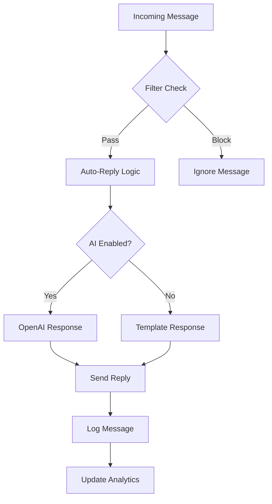

# Tervux Cloud Bot - AI Agent Documentation

## Overview

Tervux Cloud Bot is an AI-powered WhatsApp automation SaaS platform that enables users to deploy intelligent bots with advanced features including auto-reply, message filtering, anti-delete functionality, and real-time monitoring capabilities.

## Agent Capabilities

### Core Features
- **Multi-Session Management**: Handle multiple WhatsApp connections simultaneously
- **Intelligent Auto-Reply**: Context-aware responses using OpenAI integration
- **Message Filtering**: Advanced filtering with regex patterns and keyword matching
- **Anti-Delete Protection**: Prevents message deletion and maintains chat history
- **Real-Time Monitoring**: Live status updates and analytics dashboard
- **Queue Management**: Concurrency control for stable connection handling

### Bot Behaviors
- **Auto-Read**: Automatically mark messages as read
- **Anti-View-Once**: Preserve view-once media content
- **Anti-Call**: Automatically reject incoming calls
- **Always Online**: Maintain online presence
- **Always Typing**: Show typing indicator for engagement

## Technical Architecture

### Backend Services
- **Express.js API**: RESTful endpoints for bot management
- **Socket.io**: Real-time communication and status updates
- **MongoDB**: Session storage and user data persistence
- **Baileys**: WhatsApp Web protocol implementation
- **Redis**: Caching and session management
- **Node-Cron**: Automated cleanup and maintenance tasks

### Frontend Application
- **Next.js 16**: Modern React framework with App Router
- **Tailwind CSS**: Utility-first styling framework
- **shadcn/ui**: Component library for consistent UI
- **Zustand**: Lightweight state management
- **Socket.io Client**: Real-time event handling

## Agent Configuration

### Environment Variables
```env
# Database
MONGODB_URI=mongodb://localhost:27017/tervux
REDIS_URL=redis://localhost:6379

# Authentication
JWT_SECRET=your-jwt-secret
JWT_EXPIRES_IN=7d

# WhatsApp
BAILEYS_VERSION=2.2410.1

# OpenAI (for intelligent responses)
OPENAI_API_KEY=your-openai-key

# Payment Gateway
FASTLIPA_API_KEY=your-fastlipa-key
FASTLIPA_SECRET=your-fastlipa-secret

# Server
PORT=5000
NODE_ENV=production
```

### Bot Settings Schema
```javascript
{
  autoReply: {
    enabled: boolean,
    message: string,
    keywords: [string],
    aiEnabled: boolean
  },
  antiDelete: {
    enabled: boolean,
    saveDeleted: boolean
  },
  autoRead: boolean,
  antiViewOnce: boolean,
  antiCall: boolean,
  alwaysOnline: boolean,
  alwaysTyping: boolean
}
```

## API Endpoints

### Session Management
- `POST /api/sessions/pair` - Initiate WhatsApp pairing
- `GET /api/sessions` - List user sessions
- `POST /api/sessions/:id/deploy` - Deploy bot session
- `DELETE /api/sessions/:id` - Disconnect session

### Bot Configuration
- `GET /api/bots/:id/settings` - Get bot configuration
- `PUT /api/bots/:id/settings` - Update bot settings
- `POST /api/bots/:id/toggle` - Toggle bot status

### User Management
- `POST /api/auth/register` - User registration
- `POST /api/auth/login` - User authentication
- `GET /api/users/profile` - Get user profile
- `PUT /api/users/coins` - Update coin balance

## Message Handling Flow



## Deployment & Scaling

### Production Setup
1. **Backend Server**: PM2 process management
2. **Frontend Build**: Static Next.js export
3. **Database**: MongoDB replica set
4. **Cache Layer**: Redis cluster
5. **Load Balancer**: Nginx reverse proxy

### Scaling Considerations
- **Horizontal Scaling**: Multiple backend instances behind load balancer
- **Session Affinity**: WebSocket connections require sticky sessions
- **Database Sharding**: Partition user data by region
- **Rate Limiting**: Prevent API abuse and ensure fair usage

## Security Features

### Data Protection
- **End-to-End Encryption**: WhatsApp protocol encryption
- **JWT Authentication**: Secure API access
- **Input Sanitization**: Prevent XSS and injection attacks
- **Rate Limiting**: DDoS protection

### Privacy Controls
- **Data Minimization**: Only collect necessary user data
- **Session Isolation**: Multi-tenant data separation
- **Audit Logging**: Track all system activities
- **GDPR Compliance**: User data management rights

## Monitoring & Analytics

### Key Metrics
- **Session Uptime**: Bot availability percentage
- **Message Volume**: Daily/weekly message statistics
- **Response Times**: Bot reply latency measurements
- **Error Rates**: Failed operation tracking

### Health Checks
- **Database Connectivity**: MongoDB and Redis status
- **WhatsApp Connections**: Active session monitoring
- **API Performance**: Response time tracking
- **System Resources**: CPU, memory, and disk usage

## Troubleshooting

### Common Issues
1. **Connection Drops**: Check WhatsApp Web status and network stability
2. **Authentication Failures**: Verify JWT tokens and session credentials
3. **Memory Leaks**: Monitor Node.js garbage collection and session cleanup
4. **Rate Limiting**: Adjust WhatsApp API request frequency

### Debug Tools
- **Application Logs**: Pino structured logging
- **Database Queries**: MongoDB query performance analysis
- **Socket Events**: Real-time connection debugging
- **Error Tracking**: Comprehensive error reporting

## Development Guidelines

### Code Standards
- **ESLint**: JavaScript linting and formatting
- **Prettier**: Code style consistency
- **TypeScript**: Type safety for new features
- **Testing**: Unit and integration test coverage

### Best Practices
- **Error Handling**: Comprehensive try-catch blocks
- **Async/Await**: Proper promise management
- **Security**: Input validation and sanitization
- **Performance**: Efficient database queries and caching

## Future Enhancements

### Planned Features
- **Multi-Language Support**: Internationalization and localization
- **Advanced Analytics**: Detailed usage insights and reporting
- **API Webhooks**: External integrations and automation
- **Mobile Application**: Native iOS and Android apps

### Technology Roadmap
- **Microservices Architecture**: Service decomposition for scalability
- **GraphQL API**: More efficient data fetching
- **Machine Learning**: Enhanced pattern recognition and automation
- **Blockchain Integration**: Decentralized payment processing

---

## Support & Maintenance

### Contact Information
- **Development Team**: Nyaganya Malima Nyaganya
- **Technical Support**: support@tervux.cloud
- **Documentation**: https://docs.tervux.cloud

### Version History
- **v3.0.0**: Current production release
- **v2.x.x**: Legacy features and compatibility
- **v1.x.x**: Initial development and proof of concept

---

*Last Updated: March 2026*
*Copyright © 2026 Tervux Cloud. All rights reserved.*
