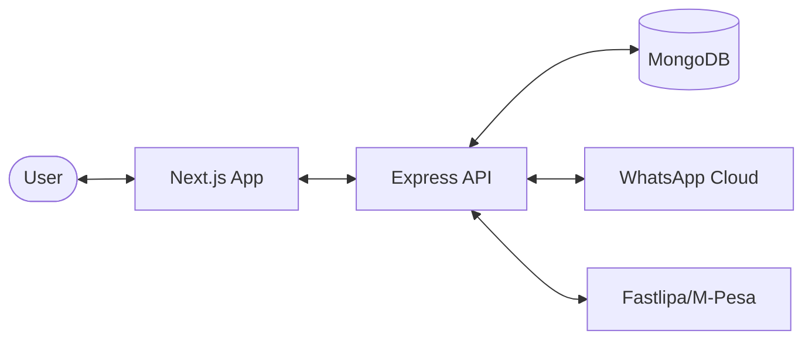

# Tervux Cloud Bot | Easy WhatsApp Automation

Tervux Cloud Bot is a powerful, production-ready SaaS platform designed for high-performance WhatsApp automation. It allows users to connect their WhatsApp accounts, manage multiple sessions, and deploy automated bots with ease.

Built with security and scalability in mind, Tervux provides a seamless interface for managing "Uplinks" (device connections) with real-time status tracking and encrypted communication.

## 🚀 Key Features

- **Multi-Device Support**: Manage multiple WhatsApp sessions from a single dashboard.
- **Real-Time Control**: Instant status updates via WebSockets and "Optimistic UI" for snappy interactions.
- **Automated Pairing**: Connect via QR Code or Pairing Code with a simple one-click setup.
- **Subscription Management**: Tiered plans with automated payment verification (Fastlipa/M-Pesa).
- **Advanced Bot Settings**: Configure Anti-Delete, Anti-View-Once, Auto-Read, and more.
- **Admin Dashboard**: Comprehensive system statistics and transaction history.

## 🏗 Project Architecture

The Tervux platform is split into two main components:

1.  **Frontend**: A modern Next.js 14 web application providing a sleek, dark-themed dashboard.
2.  **Backend**: A robust Node.js/Express API that handles session management, Baileys (WhatsApp) connections, and database persistence.

### High-Level Diagram



## 📂 Project Structure

```text
Tervux-Cloud-Bot/
├── frontend/             # Next.js web application
│   ├── app/              # App router (Pages & Layouts)
│   ├── components/       # UI & Layout components
│   └── store/            # State management (Zustand)
├── backend/              # Node.js/Express API
│   ├── models/           # Mongoose schemas
│   ├── routes/           # API Endpoints
│   ├── services/         # Core business logic
│   └── lib/              # Shared libraries
└── README.md             # This file
```

## 🛠 Deployment Guide

### Prerequisites
- **Node.js**: v18 or higher
- **MongoDB**: A running instance (local or Cloud)
- **PM2**: For process management
- **Nginx**: For reverse proxy

### 1. Backend Setup
```bash
cd backend
npm install
# Configure .env (see backend/README.md)
pm2 start server.js --name tervux-backend
```

### 2. Frontend Setup
```bash
cd frontend
npm install
# Configure .env (see frontend/README.md)
npm run build
pm2 start npm --name "tervux-frontend" -- start
```

### 3. Nginx Configuration
Configure Nginx as a reverse proxy for both the frontend (Port 3000) and backend (Port 5000).

## 📄 Documentation

For detailed information on each component, please refer to their respective READMEs:

- [**Frontend Documentation**](./frontend/README.md)
- [**Backend Documentation**](./backend/README.md)

---
© 2024 Tervux Cloud. Professional WhatsApp Automation Solutions.
