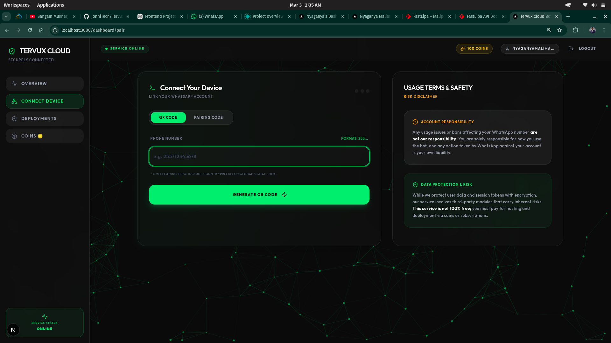

# Tervux Cloud Bot | WhatsApp Automation SaaS Platform

Tervux Cloud Bot is a powerful, production-ready SaaS platform designed for high-performance WhatsApp automation. It allows users to connect their WhatsApp accounts, manage multiple sessions, and deploy automated bots with ease.

Built with security and scalability in mind, Tervux provides a seamless interface for managing device connections (uplinks) with real-time status tracking, encrypted communication, and scalable session storage.

<p align="center">
  
</p>


## Project Architecture

The Tervux platform is split into two main components:

1. Frontend: A modern Next.js React application providing a sleek, dark-themed dashboard using Tailwind CSS and shadcn/ui.
2. Backend: A robust Node.js/Express API that handles user management, Baileys (WhatsApp) connections, Socket.io real-time events, and MongoDB database persistence.

### High-Level Diagram


## Technology Stack

The platform is built using modern, stable web technologies:

*   Frontend Framework: Next.js 16 (React)
*   Styling: Tailwind CSS and shadcn/ui components
*   State Management: Zustand
*   Backend Framework: Node.js with Express
*   Database: MongoDB with Mongoose ODM
*   Real-time Communication: Socket.io
*   WhatsApp API: Baileys library (WebSocket proxy)
*   Authentication: JSON Web Tokens (JWT)


## User Usage Flow

1.  Registration and Login: The user creates an account or logs into the web dashboard.
2.  Dashboard Access: The user navigates to the "Connect" page to link their WhatsApp account.
3.  Pairing Process: The user enters their phone number and receives an 8-character Pairing Code. They input this code into their physical WhatsApp mobile application under "Linked Devices".
4.  Connection Established: The backend securely exchanges encryption keys with WhatsApp servers, establishing a continuous WebSocket connection. The session is temporarily stored in the database.
5.  Billing and Deployment: The user purchases "Coins" via Fastlipa/M-Pesa. They use 50 coins to deploy their linked session. This action activates the bot features for a 28-day billing cycle.
6.  Configuration: The user customizes their bot's behavior (e.g., toggling Auto-Read, Anti-Delete) via the "Settings" panel on the dashboard.
7.  Monitoring: The user monitors their active sessions, disconnects them, or pauses them as needed.


## 🪙 Coin System and Usage Tracking

The platform uses a virtual currency called "Coins" (🪙) to manage bot deployments and usage. Here is how the server tracks and handles them:

*   Coin Acquisition: Users purchase coins through integrated payment gateways (e.g., Fastlipa/M-Pesa). The transaction references are verified by the system or administrators, and the purchased coins are credited to the user's account (`User` schema in MongoDB).
*   Deployment Cost: Deploying a linked WhatsApp session costs a fixed amount of coins (currently 50 🪙). This cost activates the bot features for a specific duration (e.g., 28 days).
*   Transaction Processing: When a user clicks "Deploy", the frontend makes an API call to the backend. The server explicitly checks the user's current coin balance in the database. If sufficient, exactly 50 🪙 are atomically deducted from the `user.coins` field, and the session's `expiresAt` date is set mathematically in the database.
*   Session Expiration Tracking: A Node.js `node-cron` job (`cleanupService.js`) runs every 5 minutes on the server. It scans the `WhatsAppSession` collection for any active bots where the current server time has surpassed the `expiresAt` timestamp.
*   Automated Deactivation: If an active bot has expired, the server automatically disconnects the Baileys WebSocket, clears the cached configuration, and updates the session status to "expired" in the database, requiring the user to spend more coins to reactivate it.


## Linking Queue System

To guarantee platform stability when handling a surge of new WhatsApp connections, the backend utilizes an in-memory Concurrency Queue located at `queueService.js`.

*   Concurrency Limit: The system enforces a strict maximum of 3 concurrent active pairing operations to prevent high CPU utilization and cryptographic spikes resulting from Baileys AES initializations.
*   Queue Addition: When a user requests to connect, they are added to the queue via the `/api/sessions/pair` endpoint. If the server is at maximum capacity, the user remains in the "queued" status.
*   Queue Progression: As ongoing pairings complete (either successfully or through connection timeouts), the queue naturally advances. The backend triggers the actual connection creation on the next user in line automatically.
*   Real-Time Socket Polling: Users waiting in line receive Socket.io `queue_update` broadcasts detailing their exact real-time mathematical position in line (e.g., "Position 4"). When their turn arrives, the server emits a `queue_ready` event, and the backend generates their Pairing Code or QR Code.


## Current Project Status and Implemented Features

We have completed the core infrastructure and critical user flows for the SaaS platform. The following features have been successfully implemented:

### Authentication and User Management
- Secure user registration and login system using JWT.
- Protected routes and API endpoints.
- Role-based access control (Admin vs Standard User).

### WhatsApp Session Management (Baileys)
- Custom MongoDB Authentication State Provider: Replaced local filesystem storage with database storage for Baileys session credentials, allowing for scalable, multi-tenant deployment.
- Multi-Device Support: Users can manage multiple WhatsApp sessions from a single dashboard.
- Pairing Queue System: Implemented an in-memory concurrency queue via Socket.io to protect the server from CPU/RAM spikes during simultaneous WhatsApp pairing requests.
- Flexible Connection Methods: Users can link their devices using either QR Code scanning or an 8-character Pairing Code.
- Automated Cleanup Jobs: Cron jobs to handle orphaned pairing states, expire inactive sessions, and clean up the database automatically.

### Dashboard and Bot Management
- Real-Time Control: Instant status updates via WebSockets during the pairing process.
- Bot Deployment: Users deploy their paired sessions by spending virtual "Coins", keeping the session active for a predefined period (e.g., 28 days).
- Advanced Bot Settings: UI and API support for configuring bot behaviors such as Anti-Delete, Anti-View-Once, Auto-Read, Anti-Call, Always Online, and Always Typing.
- Session Lifecycle Controls: Users can pause, resume, and disconnect their active sessions.

### Billing and Payment System
- Virtual Coin System: Users purchase and spend coins 🪙 to deploy bots.
- Subscription Plans: Database-driven pricing plans (Siku, Wiki, Mwezi).
- FastLipa M-Pesa/Tigo Integration: Automated mobile money payment processing via FastLipa API — users receive an instant STK push to enter their PIN.
- 3-Phase Payment Verification: Intelligent background verifier that (1) waits 30s for user to respond to PIN prompt, (2) checks FastLipa once at 30-60s mark, (3) auto-cancels stale payments after 60s to prevent infinite loops.
- Real-Time Payment Updates via Socket.IO: Users receive instant toast notifications when payments are confirmed, cancelled, or failed — no page refresh needed.
- Cancellation Detection: Automatically detects when users cancel or ignore payments and shows distinct UI notifications (amber warning for cancellations, red error for failures, green success for completions).
- Full Gateway Audit Trail: Every FastLipa API response is stored in the `gatewayResponse` field for debugging and financial auditing.
- Color-Coded Toast Notifications: Vibrant, distinct toast colors for each event type (emerald green for success, red for errors, amber for warnings, sky blue for info) — all positioned top-center for visibility.
- Admin Panel: Comprehensive system statistics, user management, and payment history.


## Missing Features and Next Steps

While the core SaaS routing, deployment, session management, and payment processing are complete, the following areas require further development:

- Core Message Handling Logic: While the Baileys sockets are connected and deployed, the actual event listeners for incoming messages (Auto-Reply logic, executing Anti-Delete functionality, forwarding metrics) need to be fully mapped out in the `messageHandler`.
- User Analytics: Presenting detailed message statistics, uptime, and usage metrics to the user on their dashboard.
- Developer API / Webhooks: Allowing users to connect external apps to their Tervux WhatsApp sessions via a public-facing API.


## Project Structure

```text
Tervux-Cloud-Bot/
├── frontend/             # Next.js web application
│   ├── app/              # App router (Pages & Layouts)
│   ├── components/       # UI & Layout components
│   └── store/            # State management (Zustand)
├── backend/              # Node.js/Express API
│   ├── models/           # Mongoose schemas
│   ├── routes/           # API Endpoints
│   ├── services/         # Core business logic (WhatsApp, Sockets, Queue)
│   └── lib/              # Shared libraries (DB connection, utils)
└── README.md             # This file
```


## Deployment Guide

### Prerequisites
- Node.js: v18 or higher
- MongoDB: A running instance (local or Cloud)
- PM2: For process management
- Nginx: For reverse proxy

### 1. Backend Setup
```bash
cd backend
npm install
# Configure .env
pm2 start server.js --name tervux-backend
```

### 2. Frontend Setup
```bash
cd frontend
npm install
# Configure .env
npm run build
pm2 start npm --name "tervux-frontend" -- start
```

### 3. Nginx Configuration
Configure Nginx as a reverse proxy for both the frontend (Port 3000) and backend API/Socket (Port 5000).


## Documentation

For detailed information on each component, please refer to their respective READMEs:

- [Frontend Documentation](./frontend/README.md)
- [Backend Documentation](./backend/README.md)

---
Copyright 2026 Tervux Cloud. Professional WhatsApp Automation Solutions.
